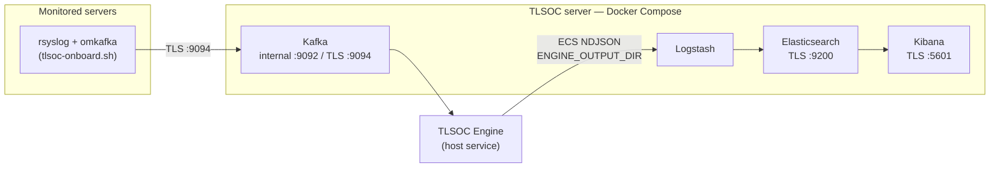

<p align="center">
  
</p>

<h1 align="center">TLSOC Docker Deploy</h1>

<p align="center">
  <b>One-command, TLS-secured SOC core stack — Apache Kafka, Logstash, Elasticsearch, and Kibana on Docker Compose — plus agentless log-source onboarding.</b>
</p>

<p align="center">
  <a href="https://github.com/sankettaware16/tlsoc"></a>
  <a href="LICENSE"></a>
  
  
  
</p>

<p align="center">
  <a href="#getting-started">Getting Started</a> •
  <a href="docs/onboarding.md">Onboard a Server</a> •
  <a href="docs/architecture.md">Architecture</a> •
  <a href="docs/kafka-admin.md">Kafka Cheat Sheet</a> •
  <a href="#tlsoc-ecosystem">Ecosystem</a>
</p>

---

## Overview

TLSOC Docker Deploy is the deployment backbone of the
[TLSOC platform](https://github.com/sankettaware16/tlsoc): a plug-and-play,
TLS-secured SOC stack for **fresh Ubuntu servers**. One installer brings up Kafka,
Logstash, Elasticsearch, and Kibana with all internal communication encrypted using
a **locally generated certificate authority** — no cloud dependencies, no manual
certificate wrangling.

Log collection is **agentless**: the bundled `tlsoc-onboard.sh` script configures any
Linux server to forward its logs with stock `rsyslog` + `omkafka` in one command,
with production safeguards (rotation-safe tailing, no replay bursts, buffered
retry) baked in and end-to-end delivery verified before it exits.

## Key Features

- **One-command install** — `install.sh` auto-detects the host IP, creates `.env`
  with **generated passwords**, generates the CA and per-service certificates,
  prepares retention and field mappings, starts the stack, and installs the
  dashboards. No manual password or Kibana setup steps.
- **Dashboards ready on day one** — the *TLSOC - SOC Overview* dashboard and the
  self-monitoring collector are installed automatically; if that step is skipped
  or fails, `sudo ./dashboards.sh` (or an automatic retry job) finishes it.
- **Retention that fits the rules and the disk** — 180-day default aligned with
  the CERT-In Directions (India), hot → warm → delete lifecycle, an optional
  shorter tier for very chatty sources, and a report that tells you whether your
  settings fit your disk. See [Data retention and storage](docs/retention-and-storage.md).
- **TLS everywhere** — Elasticsearch, Kibana, Logstash, and Kafka's external
  listener all speak TLS, signed by a local CA you control.
- **Sources connect by name** — every log source has its own Kafka topic,
  `tlsoc.logs.<source>`, created automatically; the TLSOC Engine reads them all
  and picks the parser by the same name, and the events land in
  `fosstlsoc-logs-<source>-*`. No topic to choose, nothing to map. A burst from
  one source no longer delays the others. See
  [Log sources and Kafka topics](docs/sources-and-topics.md).
- **Agentless onboarding** — one command per monitored server; auto-discovers
  common logs (auth, kern, ufw, nginx, apache, mail, fail2ban, auditd, …), lets
  you add custom paths, validates the config before restarting rsyslog, and
  verifies delivery to Kafka with a unique test marker.
- **Rotation-safe, loss-averse forwarding** — inotify file tailing that survives
  rename and copytruncate rotation, saved read-offsets (crash safety), buffered
  infinite retry when the broker is unreachable, and a private rsyslog ruleset
  that prevents forwarded lines from being swallowed by other rules.
- **Engine-ready** — Logstash tails the ECS output of
  [foss-soc-engine](https://github.com/sankettaware16/foss-soc-engine) and indexes it
  over TLS; the Kibana container supports the engine's native TLSOC Parser
  plugin.
- **Ops included** — a [Kafka admin cheat sheet](docs/kafka-admin.md) for topic
  inspection, live watching, and message counts.

## Architecture



Certificates, volumes, ports, and the Logstash pipeline are detailed in
[docs/architecture.md](docs/architecture.md).

## Getting Started

### Prerequisites

- Ubuntu **20.04 / 22.04 / 24.04** — fresh VM or bare metal recommended
- Docker Engine + Docker Compose v2

```bash
sudo apt update && sudo apt upgrade -y
sudo apt install -y ca-certificates curl gnupg lsb-release git openssl
curl -fsSL https://get.docker.com | sudo bash
sudo systemctl enable --now docker
```

### Install

```bash
cd /opt
sudo git clone https://github.com/sankettaware16/TLSOCDockerDeploy.git
cd TLSOCDockerDeploy
sudo chmod +x install.sh
sudo ./install.sh
```

The installer auto-detects the host IP (override it in `.env`), generates the
passwords and certificates, applies the retention policies and index templates,
starts the stack, and imports the dashboard. It prints the Kibana address and the
generated `elastic` password at the end (also stored in `.env`).

Open Kibana at `https://<server-ip>:5601` (user `elastic`) →
**Dashboards → TLSOC - SOC Overview**. It works immediately; panels fed by logs
fill in as soon as the [engine](https://github.com/sankettaware16/foss-soc-engine)
starts producing events.

> **If the dashboard step was skipped or failed** (Kibana still starting, or the
> installer was not run as root), run `sudo ./dashboards.sh` — it is safe to
> repeat, and as root the installer already schedules automatic retries. See
> [Dashboards and monitoring](docs/dashboards.md).

### Onboard your first log source

On the server whose logs you want to collect:

```bash
curl -fsSL https://raw.githubusercontent.com/sankettaware16/TLSOCDockerDeploy/main/tlsoc-onboard.sh -o tlsoc-onboard.sh
sudo bash tlsoc-onboard.sh
```

The script asks for the TLSOC server IP (no topic: each source goes to
`tlsoc.logs.<source>`), auto-discovers logs, and verifies end-to-end delivery. Manual template and non-interactive rollout:
[docs/onboarding.md](docs/onboarding.md).

## Usage

```bash
docker ps                        # stack status
docker logs kibana -f            # per-service logs (kibana, logstash, elasticsearch, kafka)
docker compose down              # stop
docker compose up -d             # start
```

Verify logs are arriving in Kafka:

```bash
sudo docker exec -it kafka /opt/kafka/bin/kafka-console-consumer.sh \
  --bootstrap-server kafka:9092 --topic tlsoc.logs.<source>
```

Every source at once (topic, rate, lag, parser) — on the engine host:
`cd /etc/foss-soc-engine && python3 sources.py`. More topic operations:
[docs/kafka-admin.md](docs/kafka-admin.md).

## Monitoring & SOC Overview Dashboard

The stack monitors itself. A stdlib-only collector
(`monitoring/tlsoc_health_collector.py`) runs every minute via cron and writes
one status document per component to `tlsoc-health-*`:

| Component | What is checked |
|---|---|
| elasticsearch | cluster health, heap, disk, docs, indexing rate |
| kibana | `/api/status` |
| logstash | container state + events in/out rates |
| kafka | container state + consumer-group lag |
| parser-engine | TLSOC Engine heartbeat, EPS, parse match rate |
| host | load, memory, disk |
| per log source | seconds since last event (active / stale / dead / clock-skew) |

The **"TLSOC - SOC Overview"** Kibana dashboard (imported automatically) is the
landing page for the SOC: total events and average EPS, log volume by source,
per-source freshness, pipeline health tiles (Kafka lag, parser and Logstash
throughput, heap/disk), detection-alert trends, and threat-intel stats - with
dropdown controls to filter by log source, country, and domain.

Everything is installed by `install.sh`. To (re)run it by hand at any time:

```bash
sudo ./dashboards.sh                  # full setup: retention, health collector, dashboard
./dashboards.sh --no-collector        # dashboard only, no root needed
sudo ./dashboards.sh --space <id>     # import into another Kibana space
```

Options, the automatic retry job, and troubleshooting:
[Dashboards and monitoring](docs/dashboards.md).

> **Index naming:** Logstash writes one index per service per day
> (`fosstlsoc-logs-<service>-YYYY.MM.dd`, e.g. `fosstlsoc-logs-nginx-2026.11.02`).
> New log sources need no Logstash change: the service name comes from the
> engine's output file name. Reports and dashboards query the
> `fosstlsoc-logs-*` wildcard. To use weekly indices instead (fewer shards on
> small clusters), change the date pattern in `logstash/pipeline/all.conf` to
> `%{+xxxx.ww}`.

## Repository Structure

```
├── install.sh              # One-command installer (passwords, certs, retention, stack, dashboards)
├── dashboards.sh           # Install/repair/upgrade the dashboards + health monitoring (re-runnable)
├── docker-compose.yml      # Kafka + Logstash + Elasticsearch + Kibana (TLS)
├── .env.example            # Stack configuration template (versions, passwords, IP)
├── tlsoc-onboard.sh        # Agentless log-source onboarding script
├── kafka/
│   ├── topics.conf         # Partitions/retention for source topics once they exist
│   └── setup-topics.sh     # Applies them (cron every 5 min, set up by install.sh)
├── certs/
│   └── generate-certs.sh   # Local CA + per-service certificate generation
├── logstash/
│   ├── config/             # logstash.yml, pipelines.yml
│   └── pipeline/           # all.conf (engine output → daily per-service indices)
│                           # threat_intel.conf (IOC feeds → tlsoc-threat-intel)
├── elasticsearch/
│   ├── setup_storage.py    # Retention (ILM) policies + index templates, from .env
│   ├── retention_report.py # Does your retention fit your disk?
│   └── soc-index-template.json  # Field types from the TLSOC Engine (bundled copy)
├── intel/                  # Optional threat-intel collectors (AbuseIPDB, OTX, OpenPhish, MISP)
├── monitoring/
│   ├── setup-monitoring.sh          # One-shot auto-setup (called by install.sh)
│   ├── tlsoc_health_collector.py    # Per-minute SIEM health collector (cron)
│   ├── install-health-collector.sh  # Collector + index template installer
│   └── tlsoc-health-template.json   # Mapping for tlsoc-health-* indices
├── kibana/
│   ├── generate_overview_dashboard.py  # Builds the SOC Overview dashboard
│   └── saved_objects/      # Importable dashboards/saved objects
└── docs/                   # Documentation (see below)
```

## Documentation

| Document | Contents |
|---|---|
| [Installation](docs/installation.md) | Prerequisites, install, passwords, upgrading, verification, troubleshooting |
| [Dashboards and monitoring](docs/dashboards.md) | The SOC Overview dashboard, `dashboards.sh`, the health collector, automatic retry |
| [Data retention and storage](docs/retention-and-storage.md) | Retention policy (CERT-In), sizing the disk, changing retention and templates |
| [Onboarding](docs/onboarding.md) | Automated and manual log-source onboarding (rsyslog + omkafka) |
| [Log sources and Kafka topics](docs/sources-and-topics.md) | One name per source, the per-source topics, first setup / onboarding / new parser flows, partitions |
| [Architecture](docs/architecture.md) | Services, TLS/certificates, ports, volumes, Logstash pipeline |
| [Kafka Admin](docs/kafka-admin.md) | Source topics, list/describe/watch/count/lag cheat sheet |
| [Roadmap](docs/roadmap.md) | Planned deployment work |

## TLSOC Ecosystem

TLSOC Docker Deploy is one component of TLSOC, the open-source Security Operations Platform:

| Repository | Purpose |
|---|---|
| [tlsoc](https://github.com/sankettaware16/tlsoc) | Ecosystem home — documentation, architecture, roadmap |
| [foss-soc-engine](https://github.com/sankettaware16/foss-soc-engine) | Log parsing and ECS normalization engine |
| **TLSOCDockerDeploy** (this repository) | TLS-secured core stack (Kafka, Logstash, Elasticsearch, Kibana) |
| [tlsoc-reporting-framework](https://github.com/sankettaware16/tlsoc-reporting-framework) | Declarative executive reporting (HTML/PDF) |

## Roadmap

Highlights — full list in [docs/roadmap.md](docs/roadmap.md):

- Multi-node Elasticsearch and Kafka profiles (tiered hot/warm/cold storage).
- Snapshot-based backups of retained logs.
- More bundled dashboards (per-source drill-downs for the engine's ECS output).

## Contributing

Improvements to the stack, onboarding script, and documentation are welcome — see
[CONTRIBUTING.md](CONTRIBUTING.md). Please note our
[Code of Conduct](CODE_OF_CONDUCT.md).

## Security

Report vulnerabilities privately per [SECURITY.md](SECURITY.md) — never via public
issues.

## License

Free and open-source software under the [Apache License 2.0](LICENSE).

---

<p align="center">
  Built with ❤️ by <b>TrustLab, IIT Bombay</b><br/>
  Part of the <a href="https://github.com/sankettaware16/tlsoc">TLSOC Ecosystem</a>
</p>

<p align="center">
  <a href="https://github.com/sankettaware16/tlsoc">TLSOC</a> •
  <a href="https://github.com/sankettaware16/foss-soc-engine">Engine</a> •
  <a href="https://github.com/sankettaware16/TLSOCDockerDeploy">Deploy</a> •
  <a href="https://github.com/sankettaware16/tlsoc-reporting-framework">Reporting</a>
</p>
