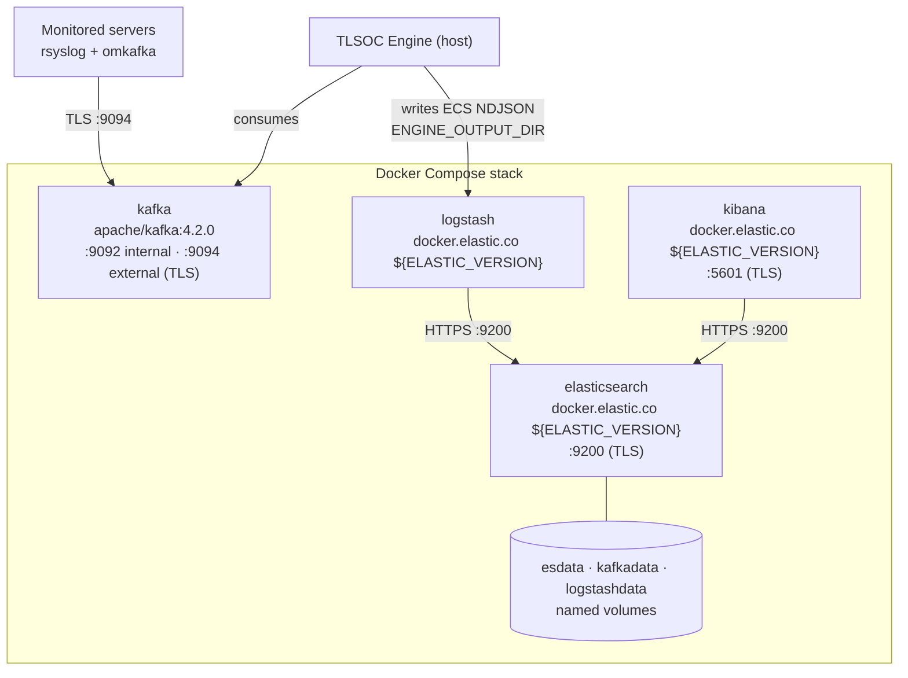
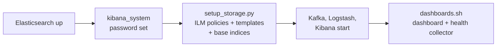

# Stack Architecture

What `docker-compose.yml` deploys and how the pieces connect. For the
platform-wide picture, see
[tlsoc — Architecture](https://github.com/sankettaware16/tlsoc/blob/main/docs/architecture.md).

## Services



| Service | Image | Exposed ports | Role |
|---|---|---|---|
| `kafka` | `apache/kafka:4.2.0` | `9094` (external TLS listener) | Log transport buffer |
| `logstash` | `docker.elastic.co/logstash/logstash:${ELASTIC_VERSION}` | — | Indexes engine output into Elasticsearch |
| `elasticsearch` | `docker.elastic.co/elasticsearch/elasticsearch:${ELASTIC_VERSION}` | `9200` | Storage and search |
| `kibana` | `docker.elastic.co/kibana/kibana:${ELASTIC_VERSION}` | `5601` (`KIBANA_PORT`) | Dashboards and search UI |

Versions and credentials come from `.env` (see
[installation.md](installation.md#configuration-reference-env)).

## TLS and certificates

`certs/generate-certs.sh <server-ip>` creates a **local certificate authority**
and issues per-service certificates signed by it:

```
certs/
├── ca/ca.crt                 # the local CA — import this on clients to trust the stack
├── elasticsearch/            # ES HTTP + transport certs
├── kibana/                   # Kibana server cert
└── logstash/                 # Logstash client certs
```

- All intra-stack communication (Logstash→ES, Kibana→ES) verifies against the
  local CA.
- Kafka's **external** listener (`:9094`) is the only port monitored servers
  need to reach.
- The server IP is baked into the certificates. `install.sh` keeps a valid
  existing set and regenerates only when the IP changed (or on first install);
  to force it, run `./certs/generate-certs.sh <new-ip>` and restart the stack.
- Browsers warn about the CA until you import `certs/ca/ca.crt` into the trust
  store; the connection is encrypted either way.

## Logstash pipelines

Logstash does **not** read Kafka directly — parsing is the engine's job. It
tails the ECS NDJSON files that
[foss-soc-engine](https://github.com/sankettaware16/foss-soc-engine) writes:

```
host: ${ENGINE_OUTPUT_DIR} (default /var/log/soc_output)   →   container: /parser_output (read-only)
```

Two pipelines run (`logstash/config/pipelines.yml`):

**`logs` — `logstash/pipeline/all.conf`**

- Tails `*.json` and the rotated `*.json.1` in tail mode, so the end of a file
  the engine just rotated is read to completion. Read positions (sincedb) live
  in the `logstashdata` volume, so a restart or container recreation neither
  re-reads nor skips events. A bounded read per file per turn stops one
  backlogged source from starving the others.
- Derives `service_name` from the file name (`nginx.json` → `nginx`) and writes
  to `fosstlsoc-logs-<service>-YYYY.MM.dd` — a new log source needs no Logstash
  change.
- Keeps the engine's `host.name` and `log.level`; removes only Logstash's own
  metadata. To save storage, set `output.include_original: false` in the engine
  instead of dropping `event.original` here.
- Outputs over HTTPS, verifying the Elasticsearch certificate against the local
  CA; the password comes from `ELASTIC_PASSWORD`.
- Throughput settings (`pipeline.batch.size`, `log.level`) are in
  `logstash/config/logstash.yml`.

**`threat_intel` — `logstash/pipeline/threat_intel.conf`**

- Tails `/parser_output/threat_intel/*.json`, written by the optional
  collectors in [`intel/`](../intel/README.md), into the `tlsoc-threat-intel`
  index with deterministic document ids (re-reads never duplicate).

**Two paths must agree:** the engine's `paths.output_dir` and `ENGINE_OUTPUT_DIR`
in `.env`.

The engine also ships an **Elasticsearch index template** that types every ECS
field correctly (dates, IPs, `geo_point`) and applies to `fosstlsoc-logs-*` —
load it before the first event is indexed:
[foss-soc-engine/elasticsearch](https://github.com/sankettaware16/foss-soc-engine/tree/main/elasticsearch).

## Retention, templates and dashboards

Set up by `install.sh` (and repairable at any time with `./dashboards.sh`) in this
order, so nothing is indexed before it is typed and covered by a retention rule:



- **Retention:** ILM policies `tlsoc-logs` (hot → warm → delete, default 180
  days), `tlsoc-logs-highvolume` (optional shorter tier) and `tlsoc-health`,
  driven by `.env`. Index templates layer the engine's field types, shard and
  replica settings and the policy for `fosstlsoc-logs-*`; an optional
  `tlsoc-logs@custom` component template is reserved for the operator. See
  [Data retention and storage](retention-and-storage.md).
- **Dashboards:** the *TLSOC - SOC Overview* dashboard reads four data views
  (`fosstlsoc-logs-*`, `tlsoc-health-*`, the Security alerts index and
  `tlsoc-threat-intel*`). Empty base indices carry the field lists so every
  panel works before the first event. The health collector
  (`monitoring/tlsoc_health_collector.py`, cron, every minute) writes
  `tlsoc-health-*`. See [Dashboards and monitoring](dashboards.md).

## Kibana extras

- `kibana/saved_objects/` — importable saved objects (Kibana → Stack Management
  → Saved Objects → Import).
- The Kibana container can host the engine's native **TLSOC Parser plugin**
  (rules/config console inside Kibana):
  [foss-soc-engine/elk-plugin](https://github.com/sankettaware16/foss-soc-engine/tree/main/elk-plugin).

## Data flow summary

1. Monitored servers publish `{meta, raw}` JSON envelopes to Kafka (`:9094`),
   one topic per log source: `tlsoc.logs.<source>`, created on that source's
   first line (nothing in advance); a cron job applies the partitions/retention
   in [`kafka/topics.conf`](../kafka/topics.conf). See
   [Log sources and Kafka topics](sources-and-topics.md).
2. TLSOC Engine (a host service, not a container) consumes every
   `tlsoc.logs.*` topic, picks the parser by the source name, normalizes to ECS,
   and writes NDJSON (`<source>.json`) to the shared output directory.
3. Logstash tails that directory and indexes into Elasticsearch over TLS.
4. Kibana serves dashboards; TLSOC Reporting queries the same indices for daily
   reports.
